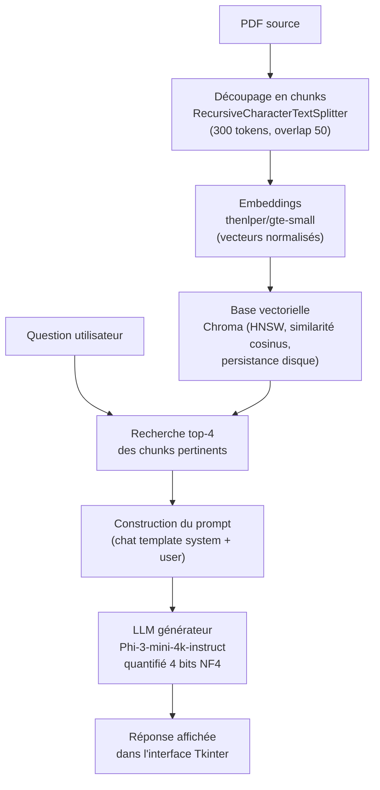

# RAG-PDF — Interrogez vos PDF avec un LLM local

**Pipeline RAG (Retrieval-Augmented Generation) 100 % local** : chargez un PDF, posez une question, obtenez une réponse générée par un LLM open-source — sans qu'aucune donnée ne quitte votre machine.


Développé en Python avec LangChain, Chroma et Transformers, avec quantification 4 bits pour tenir sur un GPU grand public.

---

## Objectifs

- **Local & privé** : aucun appel d'API externe, le LLM et les embeddings tournent sur votre machine (GPU si disponible, sinon CPU).
- **Bout en bout** : du chargement du PDF jusqu'à la réponse, avec une interface graphique qui visualise chaque étape du pipeline.
- **Configurable** : modèles, taille des chunks, quantification — tout se règle depuis l'interface.

## Architecture



## Stack technique

| Composant | Technologie | Rôle |
| --- | --- | --- |
| Interface graphique | Tkinter | Configuration, question, suivi visuel du pipeline |
| Chargement PDF | `PyPDFLoader` (pypdf) | Extraction du texte du document |
| Chunking | `RecursiveCharacterTextSplitter` | Découpage du texte en chunks alignés sur le tokenizer |
| Embeddings | `thenlper/gte-small` + sentence-transformers | Vectorisation des chunks et de la question |
| Base vectorielle | Chroma (`langchain-chroma`) | Stockage et recherche par similarité cosinus |
| LLM générateur | `microsoft/Phi-3-mini-4k-instruct` | Génération de la réponse finale |
| Quantification | BitsAndBytesConfig (4 bits NF4, double quant.) | Réduction de l'empreinte mémoire du LLM |
| Orchestration | LangChain + Transformers pipeline | Assemblage du pipeline RAG |

## Installation

Prérequis : **Python 3.10+** (Tkinter est inclus dans la distribution standard) et un **GPU CUDA** pour la quantification 4 bits (bitsandbytes). Sans GPU, le modèle bascule automatiquement en `float32` sur CPU.

```bash
pip install langchain-community langchain pypdf langchain-chroma bitsandbytes transformers sentence-transformers torch
```

## Utilisation

```bash
python main.py
```

1. L'interface s'ouvre : choisissez votre PDF via **Parcourir**.
2. Ajustez si besoin les paramètres (modèles, `CHUNK_SIZE`, `CHUNK_OVERLAP`, quantification).
3. Posez votre question dans le champ dédié et cliquez sur **Poser la question**.
4. Suivez l'avancement du pipeline en temps réel : chaque étape passe du violet (en cours) au vert (terminée).

## Paramètres configurables

| Paramètre | Défaut | Description |
| --- | --- | --- |
| `READER_MODEL_NAME` | `microsoft/Phi-3-mini-4k-instruct` | LLM générateur (Hugging Face) |
| `EMBEDDING_MODEL_NAME` | `thenlper/gte-small` | Modèle d'embeddings |
| `CHUNK_SIZE` | `300` | Taille des chunks (tokens du modèle d'embeddings) |
| `CHUNK_OVERLAP` | `50` | Chevauchement entre chunks consécutifs |
| `QUANTIFICATION_4BITS` | `True` | Quantification 4 bits NF4 du LLM (sinon float32 sur CPU) |

## Choix techniques

- **Chunking aligné sur le tokenizer** : le découpage utilise le tokenizer du modèle d'embeddings (`from_huggingface_tokenizer`), pour éviter de tronquer des tokens en pleine phrase.
- **Similarité cosinus** : les embeddings sont normalisés et l'espace HNSW de Chroma est configuré en cosinus.
- **Persistance** : la base vectorielle est sauvegardée sur disque (`db_{chunk_size}_{overlap}`), chaque configuration de chunking a donc son propre index réutilisable.
- **Génération contrainte** : prompt système strict — le modèle ne répond qu'à partir du contexte extrait et doit rester concis (`temperature=0.2`, `repetition_penalty=1.1`, max 500 tokens).
- **Retrieval top-4** : les 4 chunks les plus similaires à la question forment le contexte du prompt.

## Limites & perspectives

- [ ] Streaming de la réponse token par token
- [ ] Support multi-documents / dossier entier
- [ ] Évaluation quantitative (précision du retrieval, hallucinations)
- [ ] Serveur web (FastAPI) en alternative à Tkinter
- [ ] Quantification 4 bits sur CPU (compatibilité sans GPU)
